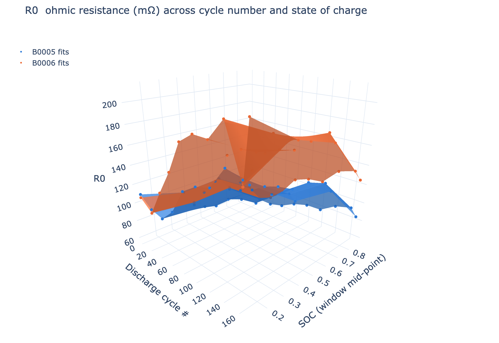
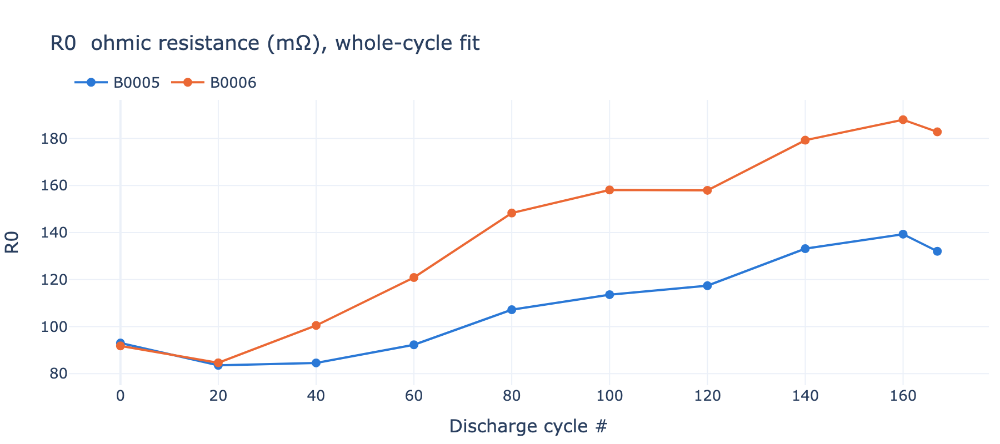
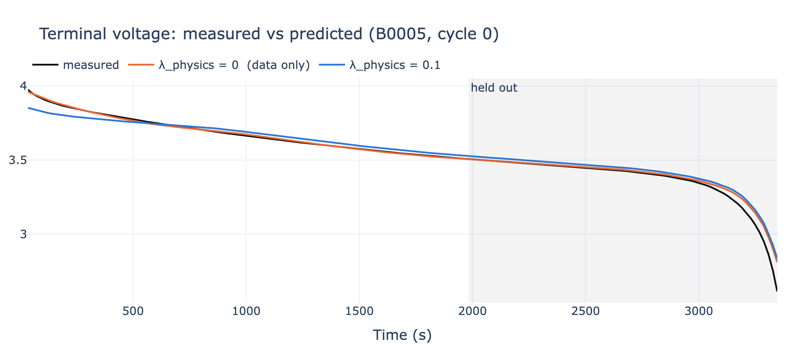
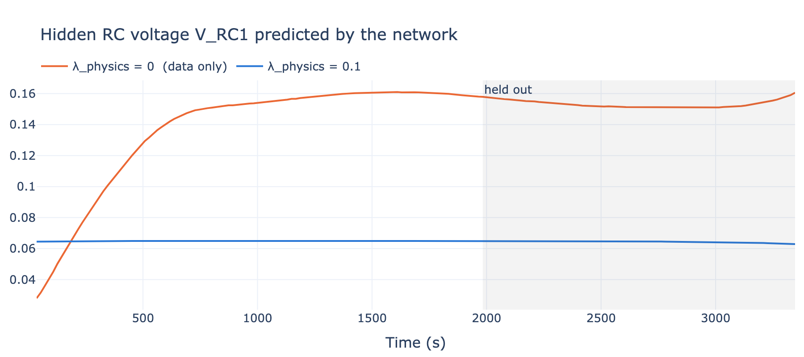

# Battery-PINN-NASA

**Tracking the internal resistance of aging lithium-ion cells with a physics-informed neural network.**

A PyTorch PINN fuses a Thevenin equivalent-circuit model with automatic differentiation to
estimate the circuit parameters R0, R1 and C1 of NASA's benchmark cells, cycle by cycle, from
fresh to end of life. An interactive Streamlit dashboard shows how those parameters drift.



---

## The problem

Lithium-ion cells degrade with every cycle. Capacity fades and internal resistance grows, and
a battery-management system needs to know *how much* in order to estimate state of health,
limit power, and predict remaining life. The internal resistance is not a sensor reading. It
has to be inferred from voltage and current, which means fitting a model.

The classic model is the **equivalent circuit (ECM)**: an open-circuit voltage source
V_oc(SOC) in series with an ohmic resistance R0 and an RC branch (R1, C1) that captures the
slow polarisation dynamics.

```
          R0        R1
 V_oc ──/\/\/\──┬──/\/\/\──┬──  V_terminal
                │          │
                └───||─────┘
                     C1
```

Fitting it to public data runs into two obstacles:

* **No open-circuit voltage.** The NASA Prognostics dataset logs terminal voltage, current and
  temperature during charge and discharge, but never V_oc(SOC). Without it, the measured
  voltage drop cannot be split between the OCV curve and the resistive terms, and every
  resistance estimate is contaminated.
* **A hidden state.** The voltage across the RC branch, V_RC1(t), is never measured either.
  It obeys a differential equation whose coefficients are exactly the parameters we are trying
  to find. Classical fitting needs to integrate that ODE inside the optimisation loop, which is
  slow and fragile with real, noisy lab data.

## The solution

A **physics-informed neural network** sidesteps both obstacles.

1. **Rebuild the OCV curve from the data itself.** State of charge is obtained by coulomb
   counting. The charge curve lies above the true OCV by the charging overpotential and the
   discharge curve below it by the discharging overpotential, so their average on a common SOC
   grid cancels most of the bias and gives a usable OCV lookup table per cell.

2. **Let a small network represent the hidden state.** A 3-32-32-1 network takes
   (time, current, temperature) and outputs V_RC1(t). The terminal voltage follows from
   Kirchhoff's law, with R0, R1 and C1 as three learnable scalars (stored as logs so they stay
   positive and update at a sensible relative rate):

   ```
   V_terminal = V_oc(SOC) − I·R0 − V_RC1
   ```

3. **Enforce the circuit ODE with automatic differentiation.** PyTorch differentiates the
   network's output with respect to its time input, so the RC equation can be evaluated at
   every data point and its violation added to the loss:

   ```
   loss = mean( V_pred − V_meas )²  +  λ · mean( dV_RC1/dt + V_RC1/(R1·C1) − I/C1 )²
   ```

   The first term fits the measurements. The second forces V_RC1 to be a solution of the
   circuit, which is the only thing that gives R1 and C1 a gradient at all.

One fit per discharge cycle takes about 1.5 s on a laptop CPU. Repeating it over a cell's life
yields the resistance-drift curves below.

## Results

Two cells (B0005, B0006), cycled at 24 °C with 2 A discharges until a 30 % capacity fade.



| cell | R0 at cycle 0 | R0 at cycle 160 | capacity fade |
|---|---|---|---|
| B0005 | 93 mΩ | 139 mΩ | 1.86 → 1.30 Ah |
| B0006 | 92 mΩ | 188 mΩ | 2.04 → 1.19 Ah |

Both cells show a monotonic rise in ohmic resistance that tracks their capacity fade, with
B0006 degrading faster on both measures. The RC time constant τ = R1·C1 stays near 50 to 60 s
throughout, as expected for a parameter that reflects electrode kinetics rather than
contact and electrolyte resistance.

### Why physics?

The same network is trained twice on the first 60 % of one discharge cycle, once with the
physics term switched off (λ = 0) and once with it on (λ = 0.1), then evaluated on the held-out
40 %.




| λ_physics | train RMSE | held-out RMSE | R1 | C1 |
|---|---|---|---|---|
| 0 (data only) | 6 mV | 41 mV | 30.0 mΩ, unchanged | 1500 F, unchanged |
| 0.1 (PINN) | 36 mV | 53 mV | 32.5 mΩ | 1618 F |

The data-only network fits the training window more tightly, but its hidden state is
meaningless: V_RC1 climbs from 30 to 160 mV with no current step to cause it, because the
network is free to absorb any mismatch there. R1 and C1 never move from their initial guesses,
since they appear only in the ODE and receive no gradient without it. The data-only model is
a voltage emulator, not a parameter estimator. The physics-constrained model keeps V_RC1 on a
physical trajectory, moves all three parameters, and is the one that can be tracked across
cycles.

## Dashboard

```bash
streamlit run Practice/dashboard.py
```

Four tabs: an interactive 3D surface of any parameter against cycle number and SOC window, 2D
drift curves with capacity fade, the "Why physics?" comparison, and the raw results table. The
dashboard reads the CSVs written by the fitting script and never runs the model itself, so it
stays responsive.

## Repository layout

```
Practice/
  soc_ocv.py        load + clean tests, coulomb-count SOC, build the OCV lookup table
  battery_pinn.py   the PINN, per-cycle fit, tracking loop, physics-vs-data-only contrast
  dashboard.py      Streamlit app
  results/          params.csv, contrast.csv, contrast_summary.csv  (outputs)
  README.md         developer notes and data-flow diagram
cleaned_dataset/    NASA data as CSV (not tracked; see below)
docs/img/           figures used in this README
```

## Getting started

```bash
git clone <this repo>
cd Battery_PINN_NASA
pip install torch numpy pandas plotly streamlit "pyarrow<21"
```

Download the NASA battery dataset as CSV (the Kaggle mirror *"NASA Battery Dataset"*
by Patrick Fleith is the cleaned version used here) and unpack it so that
`cleaned_dataset/metadata.csv` and `cleaned_dataset/data/*.csv` exist.

```bash
cd Practice
python battery_pinn.py --batteries B0005 B0006 --cycle-step 20 --windows 4 --epochs 1500
python -m streamlit run dashboard.py
```

Useful flags: `--cycle-step 10` for finer tracking, `--lambda-physics 0.01` to change the
physics weight, `--batteries B0005 B0006 B0007` to add a cell.

## Tech stack

| | |
|---|---|
| Python 3.12 | |
| PyTorch | network, learnable parameters, autograd for the ODE residual |
| NumPy | coulomb counting, OCV interpolation |
| Pandas | metadata index and per-test time series |
| Plotly | interactive 2D and 3D figures |
| Streamlit | dashboard |

## Limitations and next steps

* The OCV table is built from one fresh cycle per cell and reused for aged cycles. A
  per-cycle table, or a small learnable OCV correction, would tighten the early-cycle fit.
* R0 is one constant per fit. SOC dependence comes only from fitting on four SOC windows.
* λ is untuned at 0.1. Lower values fit the voltage more closely while still constraining
  the dynamics.
* Only two cells and one temperature. The dataset has 34 cells at 4, 24 and 43 °C, so the
  same pipeline can map how temperature accelerates resistance growth.

## Data

B. Saha and K. Goebel (2007). *Battery Data Set*, NASA Prognostics Data Repository,
NASA Ames Research Center, Moffett Field, CA.
